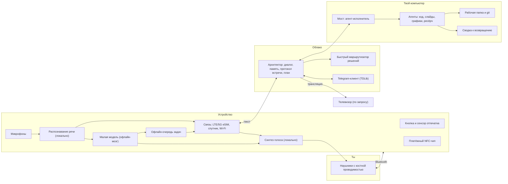

# 3. Архитектура

## Общая схема

## Компоненты

### Устройство: голосовой контур

- **Вход:** кнопка или касание сенсора отпечатка, затем речь в микрофоны.
- **Распознавание речи — локально.** Голос не уходит в сеть, уходит только текст. Это экономит канал (важно для спутника) и защищает приватность.
- **Синтез голоса — локально.** Ответ архитектора приходит текстом и озвучивается на устройстве.
- **Выход:** Bluetooth-наушники с костной проводимостью. Своих динамиков нет.

### Устройство: офлайн-мозг

Небольшая языковая модель прямо на устройстве. Она слабее облачной, но умеет:

- поддерживать разговор и помогать думать;
- записывать мысли и выводы;
- раскладывать сказанное в задачи и ставить их в **офлайн-очередь**.

Когда появляется связь, очередь синхронизируется с архитектором, и он раздаёт задачи агентам.

### Облако: Архитектор

Главный ИИ, с которым ты разговариваешь. Отвечает за:

- **диалог** в режиме спарринга (возражает, задаёт вопросы) и в режиме «просто слушай»;
- **долгую память** о тебе, твоих проектах и прошлых разговорах;
- **протокол встречи:** фиксирует выводы, решения и отложенные вопросы;
- **план:** превращает договорённости в задачи и решает, какому агенту что отдать;
- **подтверждения:** понимает, какое действие требует какого уровня подтверждения (см. [безопасность](05-security.md)).

### Облако: быстрый маршрутизатор решений

Много мелких решений не требует большой модели: «это срочно?», «какому агенту отдать?», «нужно ли подтверждение?», «это сообщение важное или шум?». Для них подходит быстрая и дешёвая модель-классификатор, которая выбирает из заранее заданных вариантов и даёт уверенность. Пример такого класса моделей — Jev от TypeSafe AI. Если уверенность низкая, решение уходит архитектору или тебе.

### Облако: Telegram

Полноценный клиент на официальной библиотеке TDLib, а не бот. Читает и пишет в твои настоящие чаты, работает с голосовыми. Живёт в облаке или на домашнем сервере, чтобы устройство оставалось лёгким.

### Компьютер: мост и агенты

- **Мост** — агент-исполнитель на твоём компьютере. Получает задачи от архитектора и запускает агентов.
- **Агенты** — пишут и собирают код, готовят презентации, визуализации, ресёрч.
- **Рабочая папка** — агенты работают в отведённой папке. Всё под git, любой шаг можно откатить.
- **Сводка** — одна страница к твоему возвращению: что сделано, что посмотреть, где агенты сомневались, что ждёт твоего решения.

### Экран по требованию

- **Телевизор:** трансляция по стандартным протоколам (Chromecast, AirPlay). Открыть, посмотреть, закрыть.
- **Ссылка в Telegram:** когда рядом нет своего ТВ.
- **Компьютер:** всё визуальное открывается там.

## Связь

| Режим | Когда | Что работает |
|---|---|---|
| LTE/5G (eSIM) | Обычно | Всё |
| Wi-Fi | Дома, в офисе, в самолёте с бортовым Wi-Fi | Всё |
| Спутник (Starlink Direct to Cell) | Мёртвые зоны на земле | Текст к архитектору и от него, Telegram. Канал узкий, но голос обрабатывается локально, поэтому хватает |
| Офлайн | Самолёт без Wi-Fi, нет покрытия | Локальный мозг и офлайн-очередь |

Для спутника не нужна специальная антенна: Starlink Direct to Cell работает с обычным LTE-модемом. Нужны модем с широким набором LTE-диапазонов и eSIM оператора-партнёра Starlink. Подробнее в [рынке](06-landscape.md#инфраструктура).

## Почему голос обрабатывается на устройстве

1. **Канал.** Текст весит килобайты, аудио — мегабайты. Это делает спутник и плохую связь рабочими.
2. **Приватность.** Сырой звук, включая голоса людей вокруг, не покидает устройство.
3. **Офлайн.** Без сети устройство всё равно понимает тебя и отвечает.
4. **Задержка.** Распознавание и озвучка без похода в сеть быстрее.
